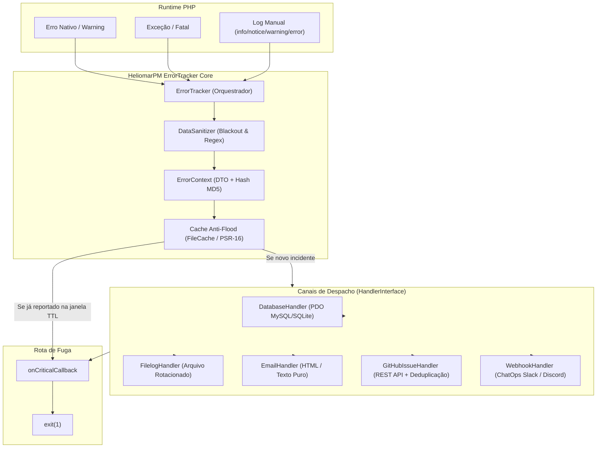

# Arquitetura do Sistema: HeliomarPM ErrorTracker

> Atualizado em: 2026-10-25

## Estilo arquitetural

Biblioteca orientada a eventos e desacoplada baseada no padrão **Strategy / Observer (Handler Pattern)**, complementada por **Interceptação Global de Erros** no runtime do PHP e um DTO imutável (`ErrorContext`).

O componente central `ErrorTracker` atua como facade e orquestrador do ciclo de vida: registra os tratadores nativos do PHP (`set_exception_handler`, `set_error_handler`, `register_shutdown_function`), sanitiza dados de requisição, calcula uma assinatura única (hash MD5) para deduplicação em cache e despacha o evento para múltiplos canais independentes que implementam `HandlerInterface`.

## Diagrama de componentes

## Fluxo da requisição e tratamento de erros

1. **Interceptação / Captura**: O método `register()` assume `set_exception_handler`, `set_error_handler` e `register_shutdown_function`. Chamadas manuais (`info`, `notice`, `warning`, `error`) sintetizam uma `ErrorException` via `debug_backtrace`.
2. **Sanitização**: `DataSanitizer` percorre recursivamente os arrays `$_POST`, `$_GET` e `$_SERVER`. Chaves críticas sofrem blackout (`********`) e padrões como e-mail, CPF, cartões e telefones recebem máscaras parciais.
3. **Contextualização & Deduplicação**: É instanciado `ErrorContext`, calculando o hash `md5(file + line + message)`. Se houver instância de `CacheInterface` configurada e a chave `error_tracker_{hash}` existir, o disparo para os handlers é silenciado para evitar *alert flood*.
4. **Despacho Isolado**: Cada `HandlerInterface` registrado recebe o `ErrorContext`. Falhas individuais de cada handler são capturadas (`try/catch Throwable`) e registradas em `error_log` nativo, impedindo falhas em cascata.
5. **Rota de Fuga (Failsafe)**: Em severidade `CRITICAL`, se houver callback registrado em `onCritical()`, este é invocado (ex: redirecionar para tela 500 amigável) e o processo é interrompido com `exit(1)` para evitar execução em estado corrompido.

## Módulos e responsabilidades

| Módulo | Caminho | Responsabilidade | Dependências |
| :--- | :--- | :--- | :--- |
| Core Tracker | `src/ErrorTracker.php` | Orquestração do ciclo de vida, hooks do PHP e despacho | `DataSanitizer`, `ErrorContext`, `HandlerInterface`, `CacheInterface` |
| Context DTO | `src/ErrorContext.php` | Agrupamento de metadados, trace, dados sanitizados e hash | `Severity` |
| Sanitização | `src/DataSanitizer.php` | Mascaramento de dados confidenciais via blackout e regex | Nenhuma (PHP puro) |
| Severidade | `src/Severity.php` | Enumeração dos níveis de criticidade dos incidentes | Nenhuma |
| Contrato Handler | `src/Contracts/HandlerInterface.php` | Interface pública para criação de canais de notificação | `ErrorContext` |
| Cache File | `src/Cache/FileCache.php` | Cache em arquivos locais compatível com PSR-16 | `Psr\SimpleCache\CacheInterface` |
| Handlers Nativos | `src/Handlers/` | Adaptadores para Banco (PDO), Arquivo de log, E-mail e GitHub | `HandlerInterface`, `PDO`, `cURL` |

## Riscos arquiteturais observados

1. **Defeito crítico em `DatabaseHandler.php`**: O método `report()` possui bloco de inserção de usuário com variáveis não declaradas (`$userId`, `$this->db`, `$sqlUser`, `$hash`). Além disso, o método `createTableIfNotExists` não cria os campos `updated_at` e `incidents` nem define chave `UNIQUE(hash)`, o que torna a query `INSERT ... ON DUPLICATE KEY UPDATE` propensa a falhas em produção.
2. **Inconsistência de nomenclatura**: O `README.md` referencia os handlers sob o namespace `HeliomarPM\ErrorTracker\Adapters`, enquanto o código real reside em `HeliomarPM\ErrorTracker\Handlers`.
3. **Chamada síncrona a serviços externos**: `GitHubIssueHandler` usa cURL síncrono (timeout de 3s) e `EmailHandler` usa `mail()` nativo síncrono, o que pode aumentar a latência de resposta em requisições de clientes com falha.

## Notas da Equipe
*(Espaço reservado para anotações manuais da equipe. A skill não altera esta seção.)*
