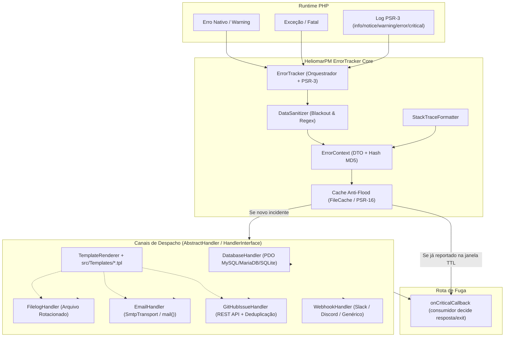

# Arquitetura do Sistema: HeliomarPM ErrorTracker

> Atualizado em: 2026-11-20

## Estilo arquitetural

Biblioteca orientada a eventos e desacoplada baseada no padrão **Strategy / Observer (Handler Pattern)**, complementada por **Interceptação Global de Erros** no runtime do PHP, implementação de **`Psr\Log\LoggerInterface` (PSR-3)** e um DTO imutável (`ErrorContext`).

O componente central `ErrorTracker` atua como facade e orquestrador do ciclo de vida: registra os tratadores nativos do PHP (`set_exception_handler`, `set_error_handler`, `register_shutdown_function`), sanitiza dados de requisição e contexto, resolve o usuário responsável, calcula uma assinatura única (`md5(file . line . message)`) para deduplicação via PSR-16 e despacha o evento para múltiplos canais independentes que implementam `HandlerInterface` (em geral estendendo `AbstractHandler`).

## Diagrama de componentes

## Fluxo da requisição e tratamento de erros

1. **Interceptação / Captura**: `ErrorTracker::create()` ou `new ErrorTracker(...)` inicializa a instância (com reconfiguração via `parameters()`). O método `register()` assume `set_exception_handler`, `set_error_handler` e `register_shutdown_function`. Chamadas PSR-3 manuais localizam a origem via `debug_backtrace` (respeitando `ignoredCallers`) e sintetizam uma `ErrorException` marcada com `isException: false`.
2. **Sanitização e Resolução de Usuário**: `ErrorTracker::processError()` filtra `$_SERVER` (`ALLOWED_SERVER_KEYS` + headers `HTTP_*`), mescla `extraContext` e submete `$_POST`, `$_GET`, `server` e `context` ao `DataSanitizer::sanitize`. O usuário é resolvido uma única vez no `ErrorTracker` (contexto da chamada → `userResolver` → `userName`) e injetado no `ErrorContext`.
3. **Contextualização & Deduplicação**: `ErrorContext` agrupa os metadados imutáveis (stack trace via `StackTraceFormatter`, origem, SQL via `context['sql']`/`context['sql_params']`, IP, Referer e hash MD5). Se houver `CacheInterface` configurada e `error_tracker_{hash}` estiver ativo no cache, o disparo aos handlers é silenciado para evitar *alert flood*.
4. **Despacho Isolado**: Cada `HandlerInterface` registrado recebe o `ErrorContext`. Os handlers nativos estendem `AbstractHandler`, reutilizando `shouldReport()` (filtro por `Severity`) e `renderer()` (instância compartilhada de `TemplateRenderer`). Falhas individuais de qualquer handler são absorvidas em `try/catch (Throwable)` e registradas via `error_log()`.
5. **Rota de Fuga (Failsafe)**: Em severidade `CRITICAL`, se houver callback em `onCritical()`, ele é invocado com o `ErrorContext`. O controle sobre redirecionamento, resposta JSON ou encerramento (`exit`) pertence integralmente ao consumidor.

## Módulos e responsabilidades

| Módulo | Caminho | Responsabilidade | Dependências |
| :--- | :--- | :--- | :--- |
| Core Tracker | `src/ErrorTracker.php` | Orquestração, PSR-3 (`LoggerInterface`), hooks do PHP e failsafe | `DataSanitizer`, `ErrorContext`, `HandlerInterface`, `CacheInterface` |
| Context DTO | `src/ErrorContext.php` | DTO imutável com metadados, traces, SQL e hash MD5 | `StackTraceFormatter`, `Severity` |
| Sanitização | `src/DataSanitizer.php` | Blackout de chaves sensíveis, máscaras regex e limite de profundidade | Nenhuma (PHP puro) |
| Severidade | `src/Severity.php` | Enumeração tipada (`CRITICAL`, `WARNING`, `NOTICE`, `DEPRECATED`, `INFO`) | Nenhuma |
| Contrato Handler | `src/Contracts/HandlerInterface.php` | Interface pública para criação de canais de notificação | `ErrorContext` |
| Handler Base | `src/Handlers/AbstractHandler.php` | Filtro de severidade `shouldReport()` e `renderer()` compartilhado | `HandlerInterface`, `TemplateRenderer`, `Severity` |
| Formatadores | `src/Formatters/` | `StackTraceFormatter` e `TemplateRenderer` (tags + condicionais) | `ErrorContext` |
| Templates | `src/Templates/*.tpl` | Templates desacoplados de e-mail HTML/texto, filelog e GitHub Issues | Nenhuma |
| Transporte SMTP | `src/Transports/SmtpTransport.php` | Cliente SMTP nativo via sockets (SSL 465 / STARTTLS 587 / AUTH LOGIN) | Nenhuma (PHP puro) |
| Cache File | `src/Cache/FileCache.php` | Cache em arquivos locais compatível com PSR-16 (`LOCK_EX`) | `Psr\SimpleCache\CacheInterface` |
| Handlers Nativos | `src/Handlers/` | `DatabaseHandler`, `EmailHandler`, `FilelogHandler`, `GitHubIssueHandler`, `WebhookHandler` | `AbstractHandler`, `PDO`, `cURL`, `SmtpTransport` |

## Pontos de atenção operacionais

1. **Chamadas síncronas em canais externos**: `GitHubIssueHandler` e `WebhookHandler` utilizam cURL síncrono (timeout padrão de `3s`) e `EmailHandler` utiliza `SmtpTransport` (timeout padrão de `10s`) ou `mail()` nativo síncrono, o que pode adicionar latência em requisições com falha caso os endpoints remotos estejam lentos.
2. **Cache anti-flood opcional**: Quando nenhuma instância PSR-16 é passada ao `ErrorTracker`, a deduplicação fica desabilitada (sem I/O implícito em disco); para produção recomenda-se fornecer `FileCache` ou cache em memória (Redis/Memcached).

## Notas da Equipe
*(Espaço reservado para anotações manuais da equipe. A skill não altera esta seção.)*
